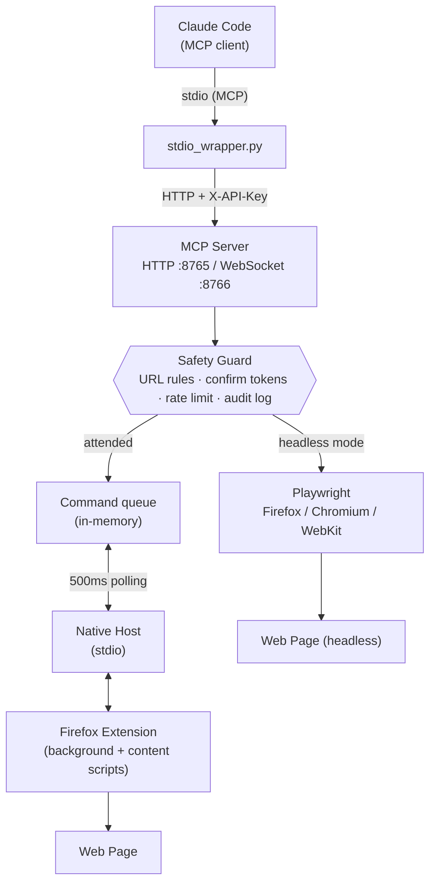

# ClaudeCodeBrowser

[](https://opensource.org/licenses/MIT)
[](https://github.com/nanogenomic/ClaudeCodeBrowser/releases)
[](https://addons.mozilla.org/firefox/)
[](https://modelcontextprotocol.io)
[](https://www.python.org)
[](#installation)

A browser automation system for Claude Code that enables AI-powered interaction with web pages — with **built-in safety guards for humans**. Take screenshots, click elements, type text, navigate pages, and **force refresh browser tabs** when launching development servers. Drive your real Firefox through the extension, or run fully headless (Firefox, Chromium, or WebKit) via Playwright.

**Author:** Andre Watson ([@nanogenomic](https://github.com/nanogenomic)) - dre@ligandal.com
**Organization:** [Ligandal Inc.](https://ligandal.com)
**License:** MIT
**Copyright:** 2025 Ligandal Inc.

## Features

- **Screenshots** - Capture visible area or full page screenshots
- **Click Automation** - Click elements by CSS selector, XPath, text, or coordinates
- **Typing** - Type text into inputs with simulated keystrokes
- **Page Navigation** - Navigate to URLs, create/close/focus tabs
- **Page Refresh** - Force refresh tabs after server restarts (bypass cache)
- **Element Inspection** - Find elements, get page info, highlight elements
- **JavaScript Execution** - Run arbitrary JS in browser context
- **Console & Network Logging** - Capture console output and fetch/XHR traffic for debugging
- **Safety Guards** - URL restrictions, protected-site confirmation, read-only mode, rate limiting, audit log ([details](#safety-guards))
- **Headless Mode** - Unattended automation via Playwright: Firefox, Chromium, or WebKit
- **MCP Integration** - Model Context Protocol server for Claude Code

## Browser Support

| Browser | Attended (extension) | Headless (Playwright) |
|---------|---------------------|----------------------|
| Firefox | ✅ Primary target (Manifest V2, AMO-signable) | ✅ `CLAUDE_BROWSER_ENGINE=firefox` (default) |
| Chromium / Chrome | 🧪 Experimental build via `scripts/build-chrome.sh` (MV3) | ✅ `CLAUDE_BROWSER_ENGINE=chromium` |
| WebKit (Safari engine) | — | ✅ `CLAUDE_BROWSER_ENGINE=webkit` |

Attended mode drives your real browser with your logged-in sessions. Headless mode launches a fresh, isolated browser — best for CI, servers, and unattended tasks. See [Headless Mode](#headless-mode).

## Overview

ClaudeCodeBrowser consists of four main components:

1. **Firefox WebExtension** - Runs in the browser to execute automation commands
2. **Native Messaging Host** - Bridge between the extension and local server
3. **MCP Server** - Model Context Protocol server exposing browser automation tools
4. **Browser Agent** - Python agent for high-level browser automation

## Architecture

### Dual-Server Design

ClaudeCodeBrowser uses a **dual-server architecture** for maximum reliability and flexibility:

| Server | Port | Protocol | Purpose |
|--------|------|----------|---------|
| **HTTP Server** | 8765 | HTTP REST | MCP tool calls, health checks, command polling, screenshot retrieval |
| **WebSocket Server** | 8766 | WebSocket | Real-time browser communication (reserved for future use) |

**Why Two Servers?**
- **HTTP (8765)**: Primary communication channel. Claude Code's MCP client sends tool requests here. The browser extension polls this server every 500ms for pending commands.
- **WebSocket (8766)**: Reserved for real-time bidirectional communication when instant responses are needed.

### Communication Flow



### Request Flow (Step by Step)

1. **Claude Code → MCP Server**: Tool call via HTTP POST to `localhost:8765/mcp/call`
2. **MCP Server → Command Queue**: Command is queued with unique ID
3. **Browser Extension → MCP Server**: Extension polls `localhost:8765/browser/poll` every 500ms
4. **MCP Server → Extension**: Pending command returned to extension
5. **Extension → Web Page**: Command executed (screenshot, click, type, etc.)
6. **Extension → MCP Server**: Response posted to `localhost:8765/browser/response`
7. **MCP Server → Claude Code**: Result returned to original MCP call

### Native Host (Optional Path)

The native messaging host (`claudecodebrowser_host.py`) provides an alternative communication path:
- Used when the browser extension needs to communicate with the local file system
- Handles screenshot saving directly to disk at `/tmp/claudecodebrowser/screenshots/`
- Enables clipboard operations and file downloads

## Installation

### Prerequisites

**System Python websockets** (required for WebSocket server on port 8766):
```bash
sudo apt install python3-websockets   # Linux
pip3 install websockets              # macOS
```

Without this, the server runs in HTTP-only mode and `browsers_connected` will always show 0. Everything else still works over HTTP.

### Quick Install (Linux and macOS)

```bash
cd ClaudeCodeBrowser
./scripts/install.sh
```

### macOS notes

The install script handles these automatically, but if you are installing manually:

- The native messaging manifest goes in `~/Library/Application Support/Mozilla/NativeMessagingHosts/` (not `~/.mozilla/`).
- The native host must live outside TCC-protected folders (`~/Documents`, `~/Desktop`, `~/Downloads`). Firefox is not allowed to execute anything there and fails with `Operation not permitted`. The default install location `~/.claudecodebrowser` is fine.
- The manifest should point to a wrapper script with an absolute `python3` path. Firefox launches native hosts with a minimal PATH, so `#!/usr/bin/env python3` may not resolve (e.g. Homebrew installs).

### Manual Installation

1. **Install the MCP server and agent:**
   ```bash
   mkdir -p ~/.claudecodebrowser/{native-host,mcp-server,agent,screenshots,logs}
   cp native-host/* ~/.claudecodebrowser/native-host/
   cp mcp-server/* ~/.claudecodebrowser/mcp-server/
   cp agent/* ~/.claudecodebrowser/agent/
   chmod +x ~/.claudecodebrowser/**/*.py
   ```

2. **Install native messaging manifest for Firefox:**
   ```bash
   # Linux
   mkdir -p ~/.mozilla/native-messaging-hosts
   cp native-host/claudecodebrowser.json ~/.mozilla/native-messaging-hosts/
   # macOS
   mkdir -p ~/Library/Application\ Support/Mozilla/NativeMessagingHosts
   cp native-host/claudecodebrowser.json ~/Library/Application\ Support/Mozilla/NativeMessagingHosts/
   # Update the path in the JSON file to point to your installation
   ```

3. **Install the Firefox extension:**
   - Open Firefox and go to `about:debugging`
   - Click "This Firefox"
   - Click "Load Temporary Add-on..."
   - Select `extension/manifest.json`

4. **Configure Claude Code MCP:**
   Add to `~/.claude/settings.json`:
   ```json
   {
     "mcpServers": {
       "claudecodebrowser": {
         "command": "python3",
         "args": ["/home/YOUR_USER/.claudecodebrowser/mcp-server/stdio_wrapper.py"]
       }
     }
   }
   ```

### Windows Installation

**Quick install (PowerShell):**

```powershell
powershell -ExecutionPolicy Bypass -File scripts\install.ps1
```

This copies the components to `%USERPROFILE%\.claudecodebrowser`, generates the
`.bat` native-host wrapper with your Python path baked in, writes the native
messaging manifest, and registers it in the Windows registry. Then load the
extension (step 1 below) and add the printed MCP config to Claude Code.

**Manual steps:**

1. **Install the Firefox extension:**
   - Open Firefox and go to `about:debugging`
   - Click "This Firefox"
   - Click "Load Temporary Add-on..."
   - Select `extension/manifest.json`

2. **Register the native messaging host:**
   Update the path in `native-host/claudecodebrowser.json` to point to the `.bat` wrapper:
   ```json
   {
     "path": "C:\\path\\to\\ClaudeCodeBrowser\\native-host\\claudecodebrowser_host.bat"
   }
   ```
   Then register it in the Registry:
   ```powershell
   New-Item -Path 'HKCU:\Software\Mozilla\NativeMessagingHosts\claudecodebrowser' -Force | Out-Null
   Set-ItemProperty -Path 'HKCU:\Software\Mozilla\NativeMessagingHosts\claudecodebrowser' -Name '(Default)' -Value 'C:\path\to\ClaudeCodeBrowser\native-host\claudecodebrowser.json'
   ```

3. **Configure Claude Code MCP:**
   Add to `%USERPROFILE%\.claude\settings.json`:
   ```json
   {
     "mcpServers": {
       "claudecodebrowser": {
         "command": "python",
         "args": ["C:/path/to/ClaudeCodeBrowser/mcp-server/stdio_wrapper.py"]
       }
     }
   }
   ```

## Updating the Firefox Extension

The MCP server and native host are plain Python — pull the repo and restart
them and you're current. **The browser extension is separate**: it runs
inside Firefox and does not update from a `git pull`. How you update it
depends on how it was installed.

Build a versioned package (both scripts also emit `dist/updates.json` for
auto-update — see below):

```bash
# Linux / macOS
./scripts/package-extension.sh          # dist/claudecodebrowser-<version>.xpi
./scripts/package-extension.sh --sign   # signed via AMO (see below)
```

```powershell
# Windows
powershell -ExecutionPolicy Bypass -File scripts\package-extension.ps1
powershell -ExecutionPolicy Bypass -File scripts\package-extension.ps1 -Sign
```

**1. Temporary add-on (development).** If you loaded it through
`about:debugging` → *Load Temporary Add-on*, it is not persistent and does
not auto-update:

- Open `about:debugging#/runtime/this-firefox`
- Find ClaudeCodeBrowser and click **Reload**, or remove it and load the new
  `manifest.json`/`.xpi` again
- It is removed on Firefox restart, so you reload it each session

This is the quickest loop while developing, and it's where you are if you've
been "reloading the plugin" after each change. When the manifest gains a new
permission (v1.3.0 added `notifications`), a reload picks it up.

**2. Signed, self-distributed `.xpi` (recommended for real use).** A signed
extension installs permanently and can **auto-update**. Sign it through
Mozilla without a public listing:

1. Create an AMO API key at
   <https://addons.mozilla.org/developers/addon/api/key/> and export it:
   ```bash
   export AMO_JWT_ISSUER=user:xxxx
   export AMO_JWT_SECRET=yyyy
   npm install -g web-ext        # one-time
   ```
2. Sign: `./scripts/package-extension.sh --sign`
   (this uploads to AMO's signer with `--channel=unlisted` and writes a
   signed `.xpi` to `dist/`).
3. Install the signed `.xpi` by opening it in Firefox (drag it onto the
   window, or `about:addons` → gear → *Install Add-on From File*).

**Auto-update is already wired** to GitHub Releases. The manifest carries:

```json
"update_url": "https://github.com/nanogenomic/ClaudeCodeBrowser/releases/latest/download/updates.json"
```

That's a stable URL — it always resolves to the newest release's
`updates.json` — and the packaging scripts generate that `updates.json`
pointing at the matching versioned `.xpi`. So each new plugin version is just:

1. Bump `version` in `extension/manifest.json`.
2. `./scripts/package-extension.sh --sign` (or the `.ps1` on Windows) — writes
   the signed `claudecodebrowser-<version>.xpi` **and** `updates.json` into
   `dist/`.
3. Publish the release with both assets — one command:
   ```bash
   ./scripts/publish-release.sh            # or --draft to review before publishing
   ```
   It reads the version from the manifest, creates the `v<version>` release,
   and uploads the `.xpi` + `updates.json`. It uses the `gh` CLI if present
   (`gh auth login`), otherwise falls back to the GitHub API with
   `GITHUB_TOKEN` (needs `repo` scope).

   <details><summary>Prefer to run it by hand?</summary>

   With the `gh` CLI:
   ```bash
   VER=$(python3 -c "import json;print(json.load(open('extension/manifest.json'))['version'])")
   gh release create "v$VER" \
     "dist/claudecodebrowser-$VER.xpi" "dist/updates.json" \
     --title "v$VER" --notes "ClaudeCodeBrowser v$VER"
   ```

   With `curl` (set `GITHUB_TOKEN`):
   ```bash
   VER=$(python3 -c "import json;print(json.load(open('extension/manifest.json'))['version'])")
   REPO=nanogenomic/ClaudeCodeBrowser
   ID=$(curl -sS -X POST "https://api.github.com/repos/$REPO/releases" \
     -H "Authorization: Bearer $GITHUB_TOKEN" \
     -d "{\"tag_name\":\"v$VER\",\"name\":\"v$VER\"}" | python3 -c "import json,sys;print(json.load(sys.stdin)['id'])")
   curl -sS -X POST "https://uploads.github.com/repos/$REPO/releases/$ID/assets?name=claudecodebrowser-$VER.xpi" \
     -H "Authorization: Bearer $GITHUB_TOKEN" -H "Content-Type: application/octet-stream" \
     --data-binary @"dist/claudecodebrowser-$VER.xpi"
   curl -sS -X POST "https://uploads.github.com/repos/$REPO/releases/$ID/assets?name=updates.json" \
     -H "Authorization: Bearer $GITHUB_TOKEN" -H "Content-Type: application/json" \
     --data-binary @"dist/updates.json"
   ```
   </details>

Installed copies check `releases/latest/download/updates.json`, see the higher
version, and update themselves within ~24h — or immediately via *Check for
Updates* in `about:addons`. (Format reference: Mozilla's
[updateURL manifest](https://extensionworkshop.com/documentation/manage/updating-your-extension/).)

> Forking? Set `CCB_REPO_SLUG=youruser/yourrepo` when packaging so the
> generated `update_link` points at your releases, and change the `update_url`
> in the manifest to match.

**3. Public AMO listing.** To distribute on
[addons.mozilla.org](https://addons.mozilla.org), run
`web-ext sign --channel=listed` (or submit the `.xpi` in the Developer Hub)
and go through Mozilla's review. Users then install and update like any store
add-on. Best when you want the extension discoverable; heavier because each
version is reviewed.

> Whichever route: bump `version` in `extension/manifest.json` first (it must
> increase for Firefox to treat a build as an update), keep it in step with
> the server version, then repackage.

## Usage

### Starting the MCP Server

```bash
~/.claudecodebrowser/start-server.sh
```

Or directly:
```bash
python3 ~/.claudecodebrowser/mcp-server/stdio_wrapper.py
```

The server runs on:
- HTTP: http://127.0.0.1:8765
- WebSocket: ws://127.0.0.1:8766

### Headless Mode

Run without any visible browser — ideal for CI, servers, and unattended tasks:

```bash
pip install playwright
playwright install firefox        # or: chromium / webkit

CLAUDE_BROWSER_HEADLESS=1 python3 mcp-server/server.py
```

Pick the engine with `CLAUDE_BROWSER_ENGINE`:

```bash
CLAUDE_BROWSER_ENGINE=chromium CLAUDE_BROWSER_HEADLESS=1 python3 mcp-server/server.py
CLAUDE_BROWSER_ENGINE=webkit   CLAUDE_BROWSER_HEADLESS=1 python3 mcp-server/server.py
```

To use a browser you already have (a system install, or a Playwright build at
a different revision) instead of running `playwright install`, point
`CLAUDE_BROWSER_EXECUTABLE` at the binary:

```bash
CLAUDE_BROWSER_ENGINE=chromium CLAUDE_BROWSER_EXECUTABLE=/usr/bin/chromium \
  CLAUDE_BROWSER_HEADLESS=1 python3 mcp-server/server.py
```

Headless mode supports the core toolset (navigate, screenshot, click, type,
scroll, element queries, script execution, eval chains, waiting, history,
keyboard, text extraction) with real multi-tab management — `browser_create_tab`
returns a `tabId` usable with `tab_id` on every other tool. The same safety
guards apply. Startup takes ~15 seconds; the server holds the first command
until the browser is ready (tunable via
`CLAUDE_BROWSER_HEADLESS_STARTUP_TIMEOUT`, default 45s).

### Using the Browser Agent

#### Interactive Mode
```bash
python3 ~/.claudecodebrowser/agent/browser_agent.py -i
```

#### Command Line
```bash
# Take a screenshot
browser-agent --screenshot

# Navigate to a URL
browser-agent --navigate https://example.com

# Get page info
browser-agent --info

# Check server status
browser-agent --check
```

#### Python API
```python
from browser_agent import BrowserAutomationAgent

agent = BrowserAutomationAgent(verbose=True)

# Navigate to a page
agent.navigate("https://example.com")

# Take a screenshot
agent.screenshot("example.png")

# Click an element
agent.click(selector="button.submit")

# Type text
agent.type_text("Hello, World!", selector="#search-input")

# Fill a form
agent.fill_form({
    "username": "myuser",
    "password": "mypass"
}, submit=True)
```

### Available MCP Tools

#### Core Navigation & Screenshots
| Tool | Description |
|------|-------------|
| `browser_screenshot` | Take a screenshot (visible area or full page) |
| `browser_navigate` | Navigate to a URL, optionally in new tab |
| `browser_go_back` | Navigate back in tab history |
| `browser_go_forward` | Navigate forward in tab history |
| `browser_refresh` | Refresh current page |
| `browser_hard_refresh` | Force refresh bypassing cache (Ctrl+Shift+R) |
| `browser_reload_all` | Reload all browser tabs |
| `browser_reload_by_url` | Reload tabs matching URL pattern |

#### Element Interaction
| Tool | Description |
|------|-------------|
| `browser_click` | Click element by selector, XPath, text, or coordinates |
| `browser_type` | Type text into an input field |
| `browser_scroll` | Scroll page or element (up/down/left/right/top/bottom) |
| `browser_hover` | Hover over an element to trigger hover effects |
| `browser_get_value` | Get the value of an input element |
| `browser_set_value` | Set input value directly (no typing simulation) |
| `browser_select_option` | Select an option in a dropdown |
| `browser_press_key` | Press a keyboard key (Enter, Escape, arrows, shortcuts) |

#### Page Inspection
| Tool | Description |
|------|-------------|
| `browser_get_page_info` | Get URL, title, forms, headings, interactive elements |
| `browser_get_text` | Extract visible text of the page or an element |
| `browser_get_elements` | Find elements matching a CSS selector |
| `browser_highlight` | Highlight an element for visual debugging |
| `browser_execute_script` | Execute JavaScript in browser context |

#### Tab Management
| Tool | Description |
|------|-------------|
| `browser_get_tabs` | List all open browser tabs |
| `browser_create_tab` | Create a new tab |
| `browser_close_tab` | Close a tab by ID |
| `browser_focus_tab` | Focus/activate a tab by ID |

#### Waiting & Synchronization
| Tool | Description |
|------|-------------|
| `browser_wait_for_element` | Wait for element to appear on page |
| `browser_wait_for_change` | Wait for DOM changes (useful after clicks) |
| `browser_wait_for_network_idle` | Wait for fetch/XHR requests to settle |
| `browser_click_and_wait` | Click element and wait for DOM changes |

#### Advanced Observation
| Tool | Description |
|------|-------------|
| `browser_observe_element` | Start observing element for changes |
| `browser_stop_observing` | Stop observing and get accumulated changes |
| `browser_scroll_and_capture` | Scroll through page capturing element info |

#### Console & Network Logging
| Tool | Description |
|------|-------------|
| `browser_start_logging` | Start capturing console logs and network requests |
| `browser_stop_logging` | Stop capturing logs (logs are preserved) |
| `browser_get_console_logs` | Retrieve captured console.log/error/warn/info/debug |
| `browser_get_network_logs` | Retrieve captured fetch/XHR requests and responses |
| `browser_clear_logs` | Clear all captured logs |

#### Human Approval, Workflows & Auditing
| Tool | Description |
|------|-------------|
| `browser_request_approval` | Ask the human at the browser to Approve/Deny an action (in-page banner + OS notification) |
| `browser_solve_captcha` | Detect a captcha and hand it to the human to solve, then continue (never auto-solves) |
| `browser_run_workflow` | Run a declarative multi-step workflow with assertions — an end-to-end test runner for web apps |
| `browser_audit_page` | One-call page audit: headings, missing alt text, unlabeled inputs, meta info + screenshot for visual critique |

#### Safety
| Tool | Description |
|------|-------------|
| `browser_safety_status` | Show active safety policy, rate-limit state, and audit log location |

### Console & Network Logging

Essential for debugging AI chat interfaces and monitoring API communications:

```bash
# Start logging before performing actions
browser-agent --start-logging

# Perform actions that you want to monitor...

# Get console logs (errors, warnings, debug output)
browser-agent --get-console-logs

# Get network logs (API requests and responses)
browser-agent --get-network-logs

# Filter console logs by level
browser-agent --get-console-logs --level error

# Filter network logs by URL pattern
browser-agent --get-network-logs --url-pattern "api/chat"

# Stop logging
browser-agent --stop-logging
```

#### Python API for Logging
```python
agent = BrowserAutomationAgent()

# Start logging
agent.start_logging(clear_existing=True)

# Perform actions...
agent.navigate("https://example.com/chat")
agent.type_text("Hello!", selector="#chat-input")
agent.click(selector="#send-button")

# Get console logs
console_logs = agent.get_console_logs(level="error")  # Filter by level
for log in console_logs['logs']:
    print(f"[{log['level']}] {log['message']}")

# Get network logs
network_logs = agent.get_network_logs(url_pattern="api/chat")
for req in network_logs['logs']:
    print(f"{req['method']} {req['url']} -> {req['status']}")
    print(f"Response: {req['responseBody'][:200]}...")

# Stop logging
agent.stop_logging()
```

#### Use Cases
- **Debug AI Chat Interfaces**: See console errors and API request/response data
- **Monitor API Communications**: Track all fetch/XHR requests with full bodies
- **Troubleshoot Errors**: Filter console logs by error level
- **Verify Integrations**: Confirm API calls are being made correctly

### Page Refresh Commands

Essential for development workflows - refresh browser tabs after server restarts:

```bash
# Refresh current tab
browser-agent --refresh

# Hard refresh (bypass cache) - like Ctrl+Shift+R
browser-agent --hard-refresh

# Reload all browser tabs
browser-agent --reload-all

# Reload all localhost tabs
browser-agent --reload-localhost

# Reload localhost on specific port
browser-agent --reload-localhost 5000

# Reload all dev server tabs (localhost, 127.0.0.1, *.local, *.dev)
browser-agent --reload-dev

# Reload tabs matching URL pattern
browser-agent --reload-url "ligandal"
```

#### Python API for Refresh
```python
agent = BrowserAutomationAgent()

# Refresh current page
agent.refresh()

# Hard refresh (bypass cache)
agent.hard_refresh()

# Reload all localhost tabs
agent.reload_localhost()

# Reload localhost:5000 specifically
agent.reload_localhost(port=5000)

# Reload all dev server tabs
agent.reload_dev_servers()

# Reload tabs matching pattern
agent.reload_by_url(url_pattern=r"localhost:500[0-9]")
```

### Tool Parameters

#### browser_click
```json
{
  "selector": "CSS selector",
  "xpath": "XPath expression",
  "text": "Text to find and click",
  "x": 100,
  "y": 200,
  "double_click": false,
  "right_click": false
}
```

#### browser_type
```json
{
  "text": "Text to type",
  "selector": "CSS selector",
  "placeholder": "Placeholder text",
  "name": "Input name",
  "clear": true,
  "press_enter": true,
  "delay": 50
}
```

#### browser_scroll
```json
{
  "direction": "down",
  "amount": 300,
  "to_element": "CSS selector"
}
```

## API Endpoints

### HTTP API (Port 8765)

| Endpoint | Method | Description |
|----------|--------|-------------|
| `/health` | GET | Server health check |
| `/mcp/tools` | GET | List available MCP tools |
| `/mcp/call` | POST | Execute an MCP tool |
| `/screenshots` | GET | List saved screenshots |
| `/browser/command` | POST | Send direct browser command |
| `/browser/response` | POST | Receive browser response |

### Example API Calls

```bash
# Health check
curl http://localhost:8765/health

# List tools
curl http://localhost:8765/mcp/tools

# Take screenshot
curl -X POST http://localhost:8765/mcp/call \
  -H "Content-Type: application/json" \
  -d '{"name": "browser_screenshot", "arguments": {}}'

# Click element
curl -X POST http://localhost:8765/mcp/call \
  -H "Content-Type: application/json" \
  -d '{"name": "browser_click", "arguments": {"selector": "button.login"}}'
```

## File Locations

| Path | Description |
|------|-------------|
| `~/.claudecodebrowser/` | Main installation directory |
| `~/.claudecodebrowser/screenshots/` | Saved screenshots |
| `~/.claudecodebrowser/logs/` | Log files |
| `~/.mozilla/native-messaging-hosts/` | Firefox native messaging manifests |

## Troubleshooting

### Extension not loading
- Ensure manifest.json is valid JSON
- Check Firefox console for errors
- Verify the extension ID matches in native messaging manifest
- After pulling a new version, remember the extension must be repackaged and
  reloaded — see [Updating the Firefox Extension](#updating-the-firefox-extension)

### Native messaging not working
- Check that the path in `claudecodebrowser.json` is correct
- Ensure the host script is executable
- Check `~/.claudecodebrowser/logs/native_host.log`

### Server connection issues
- Verify the server is running: `curl http://localhost:8765/health`
- Check `~/.claudecodebrowser/logs/mcp_server.log`
- Ensure no firewall is blocking local connections

### Screenshots not saving
- Check write permissions for `~/.claudecodebrowser/screenshots/`
- Verify the browser has the page fully loaded

## Development

### Running in development mode

1. Start the MCP server with debug logging:
   ```bash
   python3 mcp-server/server.py
   ```

2. Load the extension temporarily in Firefox

3. Use the browser agent in verbose mode:
   ```bash
   python3 agent/browser_agent.py -i -v
   ```

### Extension debugging
- Open Firefox Developer Tools (F12)
- Go to the Console tab
- Filter by "ClaudeCodeBrowser"

## Workflow Testing & Page Audits

Two tools turn the browser into a lightweight QA rig for building websites:

**`browser_run_workflow`** executes a declarative sequence of tool steps with
assertions — click through a signup flow, submit a form, verify the result —
and reports pass/fail per step with a screenshot captured at the point of
failure:

```json
{
  "steps": [
    { "label": "open app", "tool": "browser_navigate",
      "arguments": { "url": "http://localhost:3000" },
      "assert": { "selector_exists": "#login-form" } },
    { "label": "fill email", "tool": "browser_type",
      "arguments": { "selector": "#email", "text": "test@example.com" } },
    { "label": "submit", "tool": "browser_click",
      "arguments": { "selector": "button[type=submit]" },
      "assert": { "url_contains": "/dashboard", "text_contains": "Welcome" } }
  ]
}
```

Every step passes through the safety guard individually, and failing steps
capture `workflow_fail_<label>.png` automatically.

**`browser_audit_page`** gathers everything needed for a structural and visual
critique in one call: heading hierarchy, images missing alt text, unlabeled
form inputs, empty links/buttons, meta description and viewport info, page
dimensions — plus a screenshot. Point Claude at a page and ask for a critique;
this tool is the evidence-gathering step.

## Safety Guards

Every tool call passes through a safety guard before it reaches the browser.
The guard is designed to keep an automated agent from doing things the human
operating it would not expect, while staying out of the way for normal
development workflows. Policy lives in `~/.claudecodebrowser/safety.json`
(created with safe defaults on first run) and can be inspected at runtime with
the `browser_safety_status` tool.

### What the guard enforces

| Guard | Behavior |
|-------|----------|
| **URL scheme guard** | Navigation is limited to `http://`, `https://`, and `about:blank`. `file:`, `javascript:`, `data:`, `chrome:`, `resource:`, and `moz-extension:` targets are always refused. |
| **Blocklist / allowlist** | `blocked_url_patterns` refuses matching URLs; a non-empty `allowed_url_patterns` switches to allowlist mode where only matching URLs may be visited. |
| **Protected sites** | State-changing actions (click, type, navigate, script execution) on banking, payment, health, and government sites require explicit confirmation — by default from the **human at the browser** (see below), with an agent-side `confirm_token` round trip as the fallback. Read-only actions (screenshots, inspection) are unaffected. |
| **Password fields** | Typing into `<input type="password">` (or `autocomplete="current-password"/"new-password"`) is refused by default in both attended and headless modes. Credentials belong in the browser's own password manager. Set `"allow_password_typing": true` to override. |
| **Human approval (Duo-style)** | With `protected_approval` set to `"auto"` (default) or `"human"`, a protected action triggers an OS notification plus an Approve/Deny banner on the current page. The action proceeds only if the person clicks **Approve** (60s timeout = deny). `"token"` forces the agent-side flow; headless mode always uses tokens since no human is present. |
| **Read-only mode** | Set `"read_only": true` or `CLAUDE_BROWSER_READ_ONLY=1` to block every state-changing tool while keeping screenshots, page inspection, and log reading available. Useful for "look but don't touch" sessions. |
| **Script toggle** | Set `"allow_script_execution": false` or `CLAUDE_BROWSER_ALLOW_SCRIPTS=0` to disable `browser_execute_script`, `browser_eval_chain`, `browser_wait_and_act`, and `browser_inject_observer` entirely. |
| **Rate limiting** | A sliding-window cap (`max_actions_per_minute`, default 120) prevents runaway automation loops. |
| **Audit log** | Every decision (allowed, denied, confirmation requested) is appended to `~/.claudecodebrowser/logs/audit.jsonl` with sensitive argument values (typed text, scripts, passwords) redacted. |

### Example `safety.json`

```json
{
  "enabled": true,
  "read_only": false,
  "allow_script_execution": true,
  "confirm_protected_actions": true,
  "max_actions_per_minute": 120,
  "audit_log": true,
  "blocked_url_patterns": ["internal-admin\\.mycompany\\.com"],
  "allowed_url_patterns": [],
  "protected_url_patterns": ["paypal\\.com", "chase\\.com", "\\.gov(/|$)"]
}
```

The defaults include a starter set of protected patterns for common banking,
payment, brokerage, government, and health domains — edit the file to match
your own risk tolerance. Setting `"enabled": false` turns the guard off
entirely (not recommended).

### Credentials and 2FA: what this project deliberately does NOT do

- **No password vault.** ClaudeCodeBrowser never stores credentials, and by
  default refuses to type into password fields. Use the browser's own
  password manager (Firefox autofill, Bitwarden, 1Password, ...): you click
  the autofill yourself, and the secret never passes through the AI, its
  arguments, or its logs.
- **No 2FA auto-approval.** Automating Duo/TOTP/push approvals would defeat
  the purpose of a second factor. When automation reaches a login or 2FA
  wall, the right flow is: Claude pauses (use `browser_request_approval` to
  ping you), you complete the login/2FA yourself in the same tab, then
  automation continues in the authenticated session.

The Duo-style pattern this project *does* implement is pointed the other way:
**you are the second factor for Claude's actions.** Sensitive operations
push a notification to you and wait for your explicit Approve click in the
browser.

### Captchas: detect and hand off, never auto-solve

`browser_solve_captcha` follows the same human-in-the-loop principle.
Captchas exist to tell humans from bots, so auto-solving them (via OCR or
third-party solver farms) is explicitly **not** something this project does.
Instead:

- It **detects** reCAPTCHA, hCaptcha, Cloudflare Turnstile, and generic
  image/text captchas on the page.
- It **notifies you** (OS notification + an in-page banner) and **pauses**.
- **You solve it** in the same tab. For token-based widgets (reCAPTCHA,
  hCaptcha, Turnstile) it auto-detects completion and continues; otherwise
  click **Done**. `detect_only: true` just reports what's present without
  waiting.

In headless mode there is no human, so it reports what it detected and that a
human is required — re-run that step in attended mode (the Firefox extension)
so you can complete the challenge.

## Pairs Well With

ClaudeCodeBrowser is the *browser hands* of a Claude Code setup. For
secretary-style workflows, combine it with purpose-built MCP connectors
rather than screen-driving web apps: Gmail/Calendar MCP connectors handle
email triage and scheduling far more reliably than clicking through webmail,
while this project covers the parts that genuinely need a browser — visual
review of what you're building, workflow testing, form filling, and anything
without an API.

## Uninstalling

### Remove the Firefox add-on

1. Open `about:addons` in Firefox (or menu → Add-ons and themes)
2. Find **ClaudeCodeBrowser** under Extensions
3. Click the `…` menu next to it and choose **Remove**

If the extension was loaded temporarily via `about:debugging`, it disappears
on its own the next time Firefox restarts — or click **Remove** on the
`about:debugging#/runtime/this-firefox` page.

### Remove the native host and server

```bash
./scripts/uninstall.sh
```

This removes the native messaging manifest, the `~/.claudecodebrowser`
install directory, and any symlinks. If you registered the MCP server with
Claude Code, also run:

```bash
claude mcp remove claudecodebrowser
```

## Security Considerations

- The server only binds to localhost (127.0.0.1) by default
- All HTTP endpoints except `/health` require the `X-API-Key` token
  (auto-generated at `~/.claudecodebrowser/api_token`, mode 0600)
- The WebSocket control channel requires the same token as its first frame,
  so no other local process can register as the browser or forge responses
- No CORS headers are sent, so web pages cannot reach the API from the browser
- The extension refuses `runtime.onMessageExternal` messages, so co-installed
  extensions cannot issue automation commands through it
- Native messaging is restricted to the specific extension ID
- A configurable safety guard (see [Safety Guards](#safety-guards)) enforces
  URL restrictions, protected-site confirmation, read-only mode, rate
  limiting, and audit logging
- Screenshots are stored locally in user's home directory
- No data is sent to external servers

## License

MIT License - Copyright (c) 2025 Andre Watson (nanogenomic), Ligandal Inc.

See [LICENSE](LICENSE) for full details.
